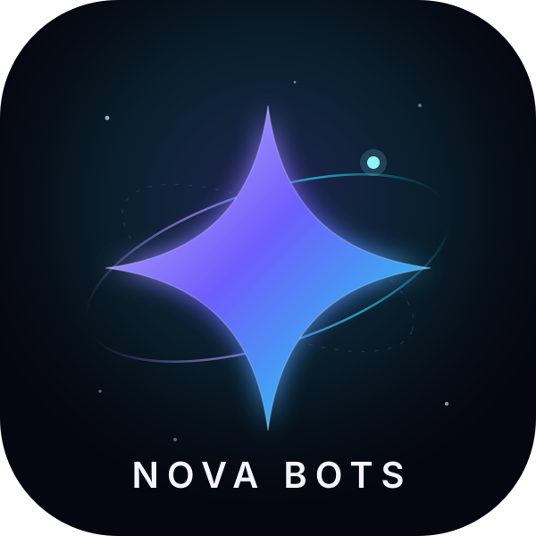

<p align="center">
  <picture>
    <source media="(prefers-color-scheme: dark)" srcset="docs/images/logo-dark.svg">
    
  </picture>
</p>

# Nova Bots

English | [中文](README.zh.md)

 

Nova Bots is a self-hosted team of long-lived AI bots. Each bot keeps its own
chat, memory and working folder; together they share group chats, hand work to
each other and report back in one place. The interface is a deep-space console:
violet-to-cyan aurora, a living starfield, glass panels and a soft glow on every
surface that matters.


## Quick start

The fastest way to run Nova Bots is Docker. It builds the whole stack — engine,
plugin, browser runtime and the Nova interface — into one container.

```sh
git clone <your-nova-bots-repository> Nova-Bots
cd Nova-Bots
cp docker/.env.example docker/.env
./nova-bots.sh start
./nova-bots.sh url
```

Open the printed login URL once. After that, **http://127.0.0.1:13080/** opens
the UI directly. For a full walkthrough — host folders, ports, models, backups
and reboot survival — read [RUNNING.md](RUNNING.md) and
[the Docker guide](docker/README.md).

### The public address

The Docker deployment publishes the workspace under a public name and signs you
in with an email and a password:

```sh
./nova-bots.sh tunnel          # print the public URLs
./nova-bots.sh tunnel-status   # connector state and reachability
```

Behind the address sits a small web front end (nginx) and a portal that keeps
the accounts and hands the request to the bots. The accounts live in their own
database; the bots' engine is bound to the loopback, so nothing but the portal
can reach it. See [RUNNING.md](RUNNING.md) for the whole shape.

### Run it as a plugin

Nova Bots also installs as a plugin into a compatible agent runtime. Build or
download `nova-bots-0.2.6.tgz`, then add it through the runtime's plugin
manager — the same page where you add any other plugin — and enable it.

The plugin package is built from [`ds-bot/`](ds-bot/). For source builds, tests
and internals, see [`ds-bot/README.md`](ds-bot/README.md).

## Meet the team

### One bot, one window

Talk to a bot the way you talk to a person. It remembers what you told it,
keeps its working folder, and picks up where it left off. Its details panel
shows its model, memory and usage; switch models there whenever you need to.


### Orion, your Main Bot

Every new team starts with **Orion**, the Mission Commander. Orion has the
highest rights: it creates, changes and removes the other bots and keeps the
group chats in order. It also walks you through setup the first time you open
the app.

Have a question? Ask Orion.

### Group chats

A group chat puts several bots on one problem. Every group has an admin: the
admin answers by default and calls in the specialists you need. You can also
`@` a bot directly and it answers you in the group. To give the group another
chat as context, use **+ → Reference a chat** in the message box.

Bots hand work to each other with `@`. The helper posts progress in the group,
finishes on its own, and the bot that asked answers with the result. The
group's details panel shows every handoff and can stop one.

Each group has its own memory. What you say in the group stays there: its
members use it, and your other chats do not see it.


### Capabilities

**Settings → Capabilities** is a shared library of MCP servers, skills and
packs. Attach a capability to a bot and it is available from that bot's next
message, in its own chat and in every group it belongs to. A local MCP command
needs your approval before it can run. While other bots use a capability, only
you or a Main Bot can change or delete it.

### Usage

**Settings → Usage** breaks token usage down by time, bot and model.


### Office files

Bots create and edit `.docx`, `.pptx` and `.xlsx` files. They can read a
document's structure with stable ids, check a package for the defects Office
would reject, make targeted edits (comments, tracked changes, fields, table
cells), reorder or duplicate slides, list workbook errors, and review rendered
pages on a contact sheet. The Docker image carries everything needed for the
full workflow.

## Your data

Everything stays on your machine. The Docker deployment keeps its state in
`docker/data/`; a plugin install keeps it in the runtime's home folder.
Uninstalling the plugin does not delete the data.

Back up `docker/data/` and `docker/.env` (stop the container first). Mounted
host folders are backed up with the rest of your files.

## Development

- [`ds-bot/`](ds-bot/) — the bot features and interface source.
- [`docker/`](docker/) — the container build, Nova brand layer and operator
  settings.
- [`nova-bots.sh`](nova-bots.sh) — start, stop, rebuild, mounts, login URL and
  the boot unit.
- [CONTRIBUTING.md](CONTRIBUTING.md) — tests, branches and review.
- [AGENTS.md](AGENTS.md) — the same rules for AI coding agents.
- [CHANGELOG.md](CHANGELOG.md) — what changed between versions.

```sh
cd ds-bot
npm ci
npm run harness
npm test
npm run build
npm run lint
```

## Credits

- [esbuild](https://esbuild.github.io/) bundles the interface code.
- The bot-memory format, group-chat rounds, chat search and handoff notes were
  informed by ideas published by AgentMemoryRepo, OpenAI Codex, OpenMausBot,
  Hermes Agent, OpenCode, goose, pi, Gemini CLI and obelisk. No code from those
  projects is included.
- Everyone who runs Nova Bots, asks questions and reports bugs.

## Links

- Product: https://bots.alilabsx.com/
- Nova (sister app): https://nova.alilabsx.com/
- Ali Labs: https://alilabsx.com/
- GitHub: https://github.com/Jahanzaib211/nova-bots
- Nova Ops: https://github.com/Jahanzaib211/nova-ops
- LinkedIn: https://www.linkedin.com/in/jahanzaib-ali-labsx

## License

[Apache License 2.0](LICENSE). Provided "as is", without any warranty.
Third-party code and its license are listed in [NOTICE](NOTICE).

## Disclaimer

Nova Bots is an independent project. Bots use your own model quota, and they
read and write files and run commands when you ask them to. Check important
actions yourself.
