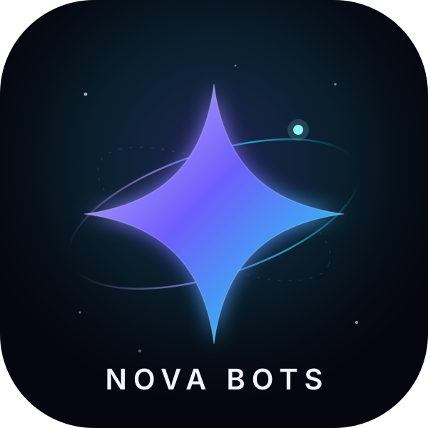
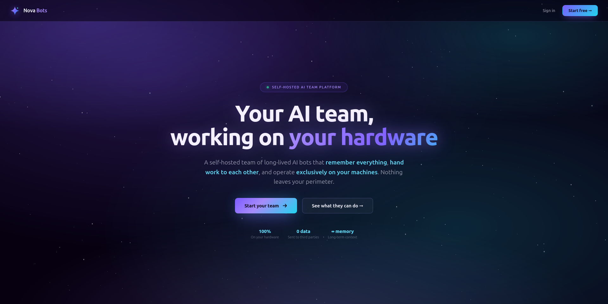

<p align="center">
  <picture>
    <source media="(prefers-color-scheme: dark)" srcset="docs/images/logo-dark.svg">
    
  </picture>
</p>

# Nova Bots

[English](README.md) | 中文

 

**组建你的 Bot 军团。**

为任何工作创建一个 Bot，给它一个角色，让它们协作：交接任务、编队作战、向指挥官汇报。每个 Bot 有自己的名字、角色、指令和模型，以及自己的对话、记忆和工作目录。小队就是群聊：Bot 之间互相发消息，用 `@` 交接任务，在同一个地方汇报结果。**Orion** 是你的指挥官（主 Bot），负责创建、修改和移除其他 Bot。自托管时，这一切都运行在你自己的机器上。

我做这个项目，是因为我宁愿自己搭，也不想租。硬件是你的，数据是你的，模型也由你选。



## 工作方式

1. **创建 Bot。** 设定名字、角色、指令和模型。
2. **组成小队。** 群聊把多个 Bot 放到同一个问题上，由管理员先回复，再按需叫来其他成员。
3. **让它们协作。** 一个调研、一个构建、一个审查：Bot 之间互相交接任务，在群里汇报进度，最后把结果交回来。每次交接你都看得到，也能随时停止。
4. **由 Orion 指挥。** 指挥官拥有最高权限，替你统领整个军团。指挥官可以不止一个。

## 快速开始

最省事的方式是 Docker。它把运行时、插件、浏览器环境和 Nova 界面打包进一个容器。

```sh
git clone https://github.com/Jahanzaib211/nova-bots.git Nova-Bots
cd Nova-Bots
cp docker/.env.example docker/.env
./nova-bots.sh start
./nova-bots.sh url
```

第一次打开打印出来的登录链接；之后直接访问 **http://127.0.0.1:13080/** 即可。主机目录、端口、模型、备份和重启存活的完整说明见 [RUNNING.md](RUNNING.md) 和 [Docker 指南](docker/README.md)。

### 公网地址

Docker 部署把工作区发布到一个公网名字下，用邮箱和密码登录：

```sh
./nova-bots.sh tunnel          # 打印公网地址
./nova-bots.sh tunnel-status   # 连接器状态和可达性
```

地址后面是一个小的网页前端（nginx）和一个保存账号、把请求交给机器人的门户。账号在自己的数据库里；机器人的引擎只绑在环回地址上，所以除了门户谁都到不了它。完整形态见 [RUNNING.md](RUNNING.md)。

### 作为插件运行

Nova Bots 也可以作为插件装进兼容的智能体运行时。构建或下载 `nova-bots-0.2.6.tgz`，在运行时的插件管理页里添加并启用它。

插件源码在 [`ds-bot/`](ds-bot/)。构建、测试和内部结构见 [`ds-bot/README.md`](ds-bot/README.md)。

### 作为桌面应用运行

Nova Bots 也有自己的 Electron 桌面应用（`app/`），自带锁定的运行时，不写用户自己的 `~/.dsh`。在 Windows、macOS、Linux 上安装。工作文件夹菜单在应用的「设置」里，也就是插件自己的对话框，里面有「选择文件夹…」——系统自己的文件夹选框，能直接浏览本地任意文件夹当作 Bot 的工作目录，不用敲路径——运行时挂载原生选框时是它（macOS 和 Windows，Linux 桌面上装了选框工具时也是）；运行时挂载应用内的文件夹浏览时是「浏览文件夹…」；「输入路径…」一直都能用。窗口本身没有 Bot 详情抽屉。构建、测试和打包见 [`app/README.md`](app/README.md)。

## 认识团队

### 一个 Bot，一个窗口

像和人说话一样和 Bot 交流。它会记住你告诉它的事，保留自己的工作目录，并在下次接着做。详情面板展示模型、记忆和用量；需要时可以随时切换模型。

### Orion，你的主机器人

每个新团队都从 **Orion**（任务指挥官、团队负责人）开始。Orion 拥有最高权限：创建、修改和移除其他 Bot，维护群聊秩序，并在你第一次打开时带你完成设置。

有问题？问 Orion。

### 群聊

群聊把多个机器人放到同一个问题上。每个群都有管理员：默认由管理员回复，并按需叫来专家。你也可以直接用 `@` 点名某个机器人，它会在群里回复你。想把另一段对话作为上下文，用输入框里的 **+ → 引用对话**。

机器人之间用 `@` 交接任务。执行者会在群里汇报进度，独立完成工作，然后由发起者给出结果。群详情里能看到每次交接，也能随时停止。

每个群有自己的记忆。你在群里说的话留在群里：群成员在群内使用，其他对话看不到。

### 能力库

**设置 → 能力** 是 MCP 服务器、技能和技能包的共享库。把能力挂到某个机器人后，它从下一条消息起就能使用，无论是在自己的对话还是所在的群聊里。本地 MCP 命令需要你批准后才能运行。其他机器人正在使用某项能力时，只有你或主机器人能修改或删除它。

### 用量

**设置 → 用量** 按时间、机器人和模型统计 token 消耗。

### Office 文件

机器人可以创建和编辑 `.docx`、`.pptx`、`.xlsx`。它们能读取文档结构并保留稳定 id，检查 Office 会拒绝的包缺陷，做定点修改（批注、修订、域、表格单元格），重排或复制幻灯片，列出工作簿错误，并在联系表上查看渲染后的页面。Docker 镜像包含完整工作流所需的全部组件。

## 你的数据

所有数据都在你自己的机器上。Docker 部署把状态放在 `docker/data/`；插件安装则放在运行时的 home 目录。卸载插件不会删除数据。

备份时先停止容器，再备份 `docker/data/` 和 `docker/.env`。挂载进来的主机目录跟随你原有的备份策略。

## 开发

- [`ds-bot/`](ds-bot/) — 机器人功能与界面源码。
- [`docker/`](docker/) — 容器构建、Nova 品牌层和运维配置。
- [`nova-bots.sh`](nova-bots.sh) — 启动、停止、重建、挂载、登录链接和开机单元。
- [CONTRIBUTING.zh.md](CONTRIBUTING.zh.md) — 测试、分支和评审。
- [CHANGELOG.md](CHANGELOG.md) — 版本变更。

```sh
cd ds-bot
npm ci
npm run harness
npm test
npm run build
npm run lint
```

## 致谢

- [esbuild](https://esbuild.github.io/) 打包界面代码。
- 机器人记忆格式、群聊轮次、聊天搜索和交接笔记参考了 AgentMemoryRepo、OpenAI Codex、OpenMausBot、Hermes Agent、OpenCode、goose、pi、Gemini CLI 和 obelisk 公开发布的设计思路；不包含这些项目的代码。
- Nova Bots 源自 Fei2411 和 DS Bot 贡献者的 [DS Bot](https://github.com/Fei2411/DS-Bot)，采用 Apache 2.0 许可证；其声明保留在 [NOTICE](NOTICE) 中。
- 每一位运行 Nova Bots、提出问题并报告缺陷的人。

## 链接

- 产品：https://bots.alilabsx.com/
- Nova（姊妹应用）：https://nova.alilabsx.com/
- Ali Labs：https://alilabsx.com/
- GitHub：https://github.com/Jahanzaib211/nova-bots
- LinkedIn：https://www.linkedin.com/in/jahanzaib-ali-labsx

## 许可证

[Apache License 2.0](LICENSE)。按“原样”提供，不附带任何担保。第三方代码及其许可证列在 [NOTICE](NOTICE)。

## 免责声明

Nova Bots 是一个独立项目。机器人使用你自己的模型额度；当你要求时，它们会读写文件并运行命令。重要操作请自己复核。

## 合作

Nova Bots 由 Jahanzaib Ali 开发，他是 AliLabsX 的创始人兼系统工程师。如果你需要自己的 Bot 军团、自托管部署，或平台工程方面的帮助，欢迎联系。如果不想自己运行，也可以用托管版：https://bots.alilabsx.com。

- 邮箱：Jahanzaib@alilabsx.com
- 网站：https://alilabsx.com
- LinkedIn：https://www.linkedin.com/in/jahanzaib-ali-labsx
